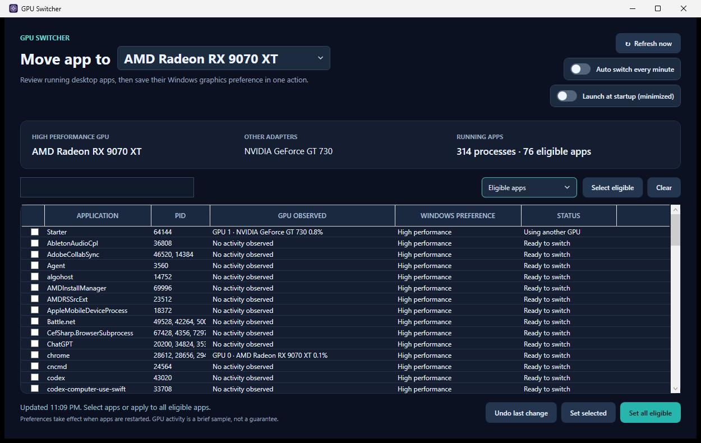

<div align="center">
  
  <h1>GPU Switcher</h1>
  <p>Set Windows graphics preferences for running desktop apps in one place.</p>
</div>

GPU Switcher lists running applications, shows which GPU they used during a short sample, and can set their Windows graphics preference to **High performance**, **Power saving**, or a named GPU in one batch. It also has an optional mode that checks for newly running apps every minute.

[Download the latest Windows executable](https://github.com/thoaionline/gpu-switcher/releases/latest).



## Features

- **See what is running.** Processes sharing an executable are grouped into one application row. The list starts with **Using other GPU** selected relative to the chosen target; search by name or path, or switch to the full process list.
- **Compare use with preference.** The table shows both sampled GPU activity and the preference saved in Windows. An idle app may have no activity to show.
- **Choose the target.** Use the title dropdown for High performance, Power saving, or an available named GPU. Named GPU choices use the hardware IDs Windows saves for its Specific GPU option.
- **See the target at a glance.** The window and taskbar icon change with the selection: a cyan bolt for High performance, a green leaf for Power saving, and a violet target for a named GPU.
- **Apply in bulk or selectively.** Set all eligible apps or choose individual rows. Windows and protected processes are excluded.
- **Keep new apps covered.** Turn on **Auto switch every minute** to scan immediately and then every 60 seconds while the window is open. Apps already set to the selected target are skipped; an unchanged cycle makes no registry writes.
- **Launch with Windows.** Turn on **Launch at startup (minimized)** to start GPU Switcher minimized when you sign in to your Windows account. Turn it off to remove the startup entry.
- **Undo the latest batch.** The previous registry values are saved before a batch and can be restored with **Undo last change**. Undo also turns automatic switching off.

## Requirements

- Windows 10 version 1803 or later, or Windows 11
- Two or more GPUs for switching to be useful
- [.NET 10 Desktop Runtime (x64)](https://dotnet.microsoft.com/en-us/download/dotnet/10.0) to run the release executable, or the .NET 10 SDK to build and run from source

Preferences are saved for the current Windows user. Administrator access is not required.

## Run from source

Open the solution in Visual Studio with the **.NET desktop development** workload, or run this from the repository root in PowerShell:

```powershell
dotnet run --project .\GpuSwitcher\GpuSwitcher.csproj
```

The app scans on launch. Choose a target in the title dropdown, then use **Set all eligible** for a one-time batch, or enable **Auto switch every minute** to keep checking while the app stays open. Restart affected applications for the new preference to take effect. Use **Undo last change** to restore the most recent batch; each later batch replaces that backup.

## Build a single Windows executable

From the repository root on Windows:

```powershell
dotnet publish .\GpuSwitcher\GpuSwitcher.csproj -c Release -p:PublishProfile=SingleFileWinX64 -o .\dist\win-x64
```

The resulting `dist\win-x64\GpuSwitcher.exe` is the only file you need to distribute. It does not include .NET. If the .NET 10 Desktop Runtime is missing, the .NET host shows a download prompt. The `dist` directory is ignored by Git; build outputs are not part of the source repository.

GPU Switcher builds are currently unsigned, so [Windows Smart App Control](https://learn.microsoft.com/en-us/windows/apps/develop/smart-app-control/overview) may block an unfamiliar executable. Broadly trusted distribution requires code signing.

## How it works and what to expect

GPU Switcher identifies adapters through DXGI and samples the Windows **GPU Engine** performance counters. The activity column describes a brief observation, not a guarantee about which GPU an app will use later. High performance and Power saving ask Windows to choose an adapter in that category. A named GPU asks Windows to prefer the selected adapter. An app can still choose another device through its own settings or graphics API.

For each selected desktop executable, the app writes under `HKCU\Software\Microsoft\DirectX\UserGpuPreferences`, preserving unrelated settings in that value. High performance uses `GpuPreference=2;`, Power saving uses `GpuPreference=1;`, and a named GPU uses Windows' `SpecificAdapter=VEN&DEV&SUBSYS;GpuPreference=1073741824;` form. It rechecks the saved preference before writing, so an app already set to the target is left untouched. This registry format is not a documented public API and could change in a future Windows release. Adapters with the same hardware ID appear as one named choice because Windows cannot distinguish them through this setting.

Apps with inaccessible executable paths cannot be changed. Automatic switching runs only while the window is open and starts **off** each time the app launches.

The startup toggle saves the current executable path under `HKCU\Software\Microsoft\Windows\CurrentVersion\Run` with a `--minimized` launch argument. It does not turn on automatic switching. If you move the app folder, open the copy in its new location and turn on the startup toggle there to update the path.

An eligible app is a readable desktop `.exe` outside the Windows directory. GPU Switcher excludes itself and does not change Windows system processes or apps whose executable path is inaccessible.

## Contributing

Bug reports and pull requests are welcome. Please describe the Windows version and GPU setup when reporting detection or preference issues. Build the project and check that the window launches before submitting a code change.

## License

GPU Switcher is released under the [MIT License](LICENSE).
